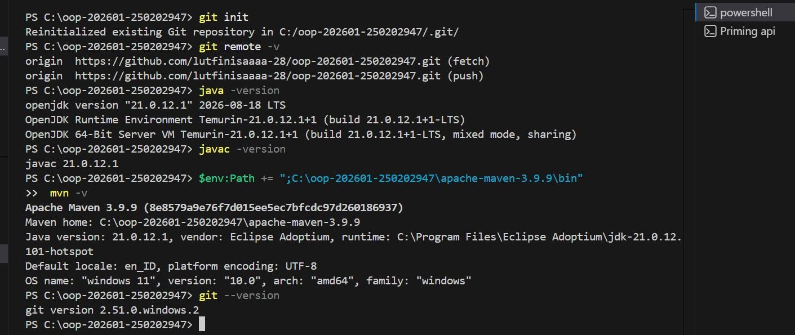
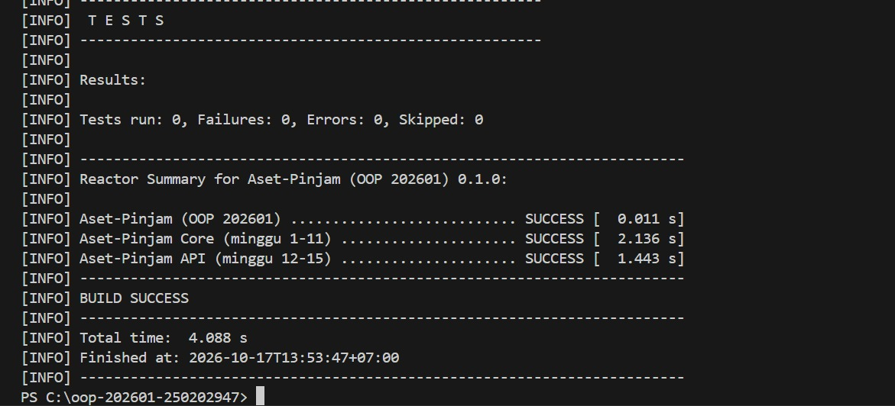

# Catatan Minggu 01 NN: (Paradigma Pemograman dan Stup)

Salin berkas ini menjadi `catatan/minggu-NN.md` (NN dua digit, misalnya `minggu-07.md`).

## Yang saya kerjakan
Minggu ini saya menyiapkan lingkungan kerja (JDK, Maven, dan VS Code), lalu membuat program sapaan "Hello Aset-Pinjam" dalam tiga gaya: prosedural, OOP, dan fungsional. Data nama dan NIM saya baca dari berkas `mahasiswa.properties`, dan ketiga gaya harus menghasilkan keluaran yang persis sama. 

## Dokumentasi

## Keputusan desain
Program sapaan "Hello Aset-Pinjam" 
saya buat dalam tiga gaya (prosedural, OOP, fungsional) di kelas terpisah pada paket `minggu01`, supaya perbedaan tiap gaya mudah dibandingkan. Ketiganya harus menghasilkan keluaran yang sama persis karena `Minggu01Test` membandingkan string secara literal, termasuk spasi.

## Kendala
Pada saat mengecek mengecek maven ternyata java belum ke donwload akhirnya harus mendonwload terlebih dahulu dan pada saat pengecekan terdapat eror karna salah penulisan kode.

## Penggunaan AI
- Alat yang dipakai: Claude
- Bagian yang dibantu AI: Saat mencari kode baru saat eror pada saat pengecekan
- Prompt utama: Pada saat mendonwload java winget install EclipseAdoptium.Temurin.21.JDK
- Yang saya ubah atau tolak dari saran AI, dan alasannya: Tidak ada
- Satu hal yang saya pahami lebih baik sekarang:Gambaran memasukan kode dan fungsional
